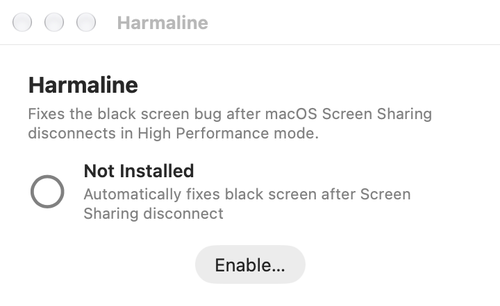

# Harmaline

Harmaline restores a MacBook’s backlight when disconnecting from High Performance Screen Sharing leaves it black. A background daemon detects the session ending and restores brightness and brightness-key behavior, avoiding a forced shutdown.



**Archived:** this repository is retained for reference.

## Install

### App

**[Download Harmaline.dmg](https://kagerou.glass/get/harmaline?from=readme)** or build the app from source. For the first launch, use **System Settings → Privacy & Security →
Open Anyway**, or run `xattr -cr /Applications/Harmaline.app`. To build it:

```bash
git clone https://github.com/kageroumado/harmaline.git
cd harmaline
Scripts/build-app.sh
```
This builds `Harmaline.app` in `.build/`. 

Open it and click **Enable** — you'll be prompted for your admin password to install the background daemon.

The app is only needed for enabling/disabling the daemon. Once enabled, the daemon runs independently in the background and persists across reboots. You can quit or delete the app.

### CLI Only

```bash
git clone https://github.com/kageroumado/harmaline.git
cd harmaline
sudo Scripts/install.sh
```

## Uninstall

**Via app:** Open Harmaline and click **Disable**.

**Via CLI:**
```bash
sudo Scripts/uninstall.sh
```

## Emergency Fix

If your screen is black right now:

```bash
# SSH into the Mac, then:
swift build -c release
sudo .build/release/harmaline --fix
```

Or check the current display state:
```bash
sudo .build/release/harmaline --status
```

## Logs

- **Structured log**: `/Library/Logs/Harmaline.log`
- **Unified logging**: `log show --predicate 'subsystem == "glass.kagerou.harmaline"'`

## Requirements

- macOS 14 (Sonoma) or later
- Apple Silicon Mac with built-in display

[Detection and recovery internals](REFERENCE.md).
